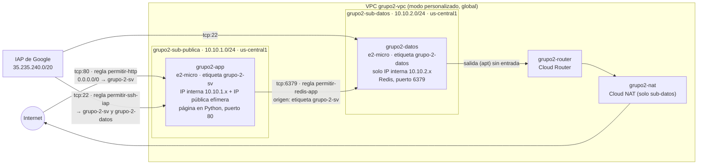
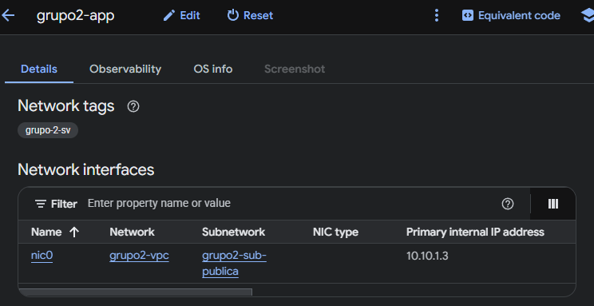
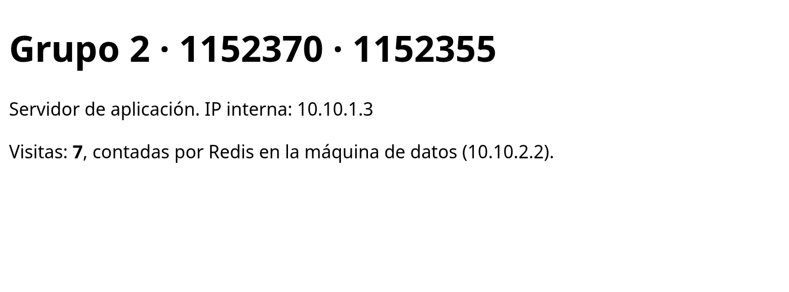

# Práctica 3 — Una red propia, dos máquinas y una aplicación

| Dato | Información |
|---|---|
| **Equipo** | Grupo 2: Jorge Reyes ([JorgeAgar](https://github.com/JorgeAgar)) y Adolfo Alejandro Arenas ([a-cubica-r](https://github.com/a-cubica-r)) |
| **Códigos** | Jorge Reyes 1152355 · Adolfo Alejandro Arenas 1152370 |
| **Proyecto de Google Cloud** | `project-56eb9056-3ab4-4adb-b64` |
| **Prefijo de los recursos** | `grupo2` |
| **Región / zona** | `us-central1` / `us-central1-a` |

## 1. Diagrama de infraestructura



La entrada pública llega solo a `grupo2-app` por el puerto 80. La máquina de datos no tiene dirección pública: sale a internet por Cloud NAT (para instalar Redis) y solo la alcanzan la aplicación, en el 6379, e IAP, en el 22.

## 2. Evidencias por fase

### Fase 0 — Preparación

`terraform version` y `gcloud config list` en Cloud Shell, con el proyecto correcto.


### Fase 1 — La red y su subred

Lista de subredes de `grupo2-vpc` y salida del apply con los dos recursos creados.


### Fase 2 — Variables y salidas

`terraform plan` sin cambios en la infraestructura (solo aparecen las dos salidas nuevas) y `terraform output` con los dos valores.


### Fase 3 — La aplicación

La instancia `grupo2-app` con su interfaz en `grupo2-vpc` / `grupo2-sub-publica` y la IP interna `10.10.1.3`, dentro de `10.10.1.0/24`.




### Fase 4 — Las puertas

La aplicación abierta en un teléfono con datos móviles, las dos reglas de cortafuegos con sus orígenes y etiquetas, y una sesión SSH establecida por IAP.


> En la captura 4.1 se ven dos fallas del primer `arranque.sh`: los acentos salen mal porque la página no declaraba `charset`, y aparece la palabra `HTML` porque el terminador del *heredoc* estaba sangrado y bash no lo reconocía. Las dos quedaron corregidas en el script del reto.

### Fase 5 — Reproducir desde cero

Destrucción completa (5 recursos), listados vacíos y reconstrucción con la aplicación respondiendo. El destroy borró primero las reglas y la máquina, después la subred y al final la red. Nadie escribió ese orden: Terraform lo saca del grafo de dependencias, recorrido al revés.

- [Final del destroy](evidencias/fase5/1-destroy.txt)
- [Listados vacíos de instancias y redes](evidencias/fase5/2-listados-vacios.txt)
- [Apply posterior](evidencias/fase5/3-apply.txt)
- [La aplicación respondiendo después de reconstruir](evidencias/fase5/4-curl-nueva-ip.txt)

```text
Destroy complete! Resources: 5 destroyed.
$ gcloud compute instances list
Listed 0 items.
$ gcloud compute networks list
NAME     SUBNET_MODE  BGP_ROUTING_MODE  IPV4_RANGE  GATEWAY_IPV4  INTERNAL_IPV6_RANGE
default  AUTO         REGIONAL
...
Apply complete! Resources: 5 added, 0 changed, 0 destroyed.
ip_publica = "35.232.75.145"
$ curl -m 8 http://35.232.75.145
  <p>Servidor de aplicación. IP interna: 10.10.1.2</p>
```

Esta vez la IP pública coincidió con la de antes del destroy: Google la devolvió al grupo y nos la volvió a asignar. Que salga igual es casualidad, no está garantizado. En la fase 4 la máquina tenía `34.171.253.57` y en el reto `35.253.221.200`, así que nada del código depende de ese valor.

### Fase 6 — Reto: la máquina que nadie puede alcanzar

**La página mostrando el dato que vino de la máquina privada.** En cada visita, la aplicación le pide a Redis, en `grupo2-datos`, que sume uno al contador `visitas`, y muestra el resultado.



**Intento externo que no responde** ([evidencia completa](evidencias/fase6/1-aislamiento-externo.txt)). `grupo2-datos` no tiene IP externa, su IP interna no existe fuera de la VPC y el 6379 tampoco se alcanza a través de la IP pública de la aplicación:

```text
NAME          ZONE           MACHINE_TYPE  PREEMPTIBLE  INTERNAL_IP  EXTERNAL_IP     STATUS
grupo2-app    us-central1-a  e2-micro                   10.10.1.3    35.253.221.200  RUNNING
grupo2-datos  us-central1-a  e2-micro                   10.10.2.2                    RUNNING

$ curl -sS -m 8 telnet://10.10.2.2:6379
curl: (28) Connection timed out after 8001 milliseconds
$ curl -sS -m 8 telnet://35.253.221.200:6379
curl: (28) Connection timed out after 8001 milliseconds
```

**Consulta interna que sí responde** ([evidencia completa](evidencias/fase6/2-consulta-interna-desde-app.txt)). Desde `grupo2-app`, entrando por IAP, Redis contesta en la IP interna. En cambio, el 22 de la máquina de datos no se alcanza desde la aplicación, porque la regla interna solo abre el 6379:

```text
grupo2-app
$ printf "PING\r\n" > /dev/tcp/10.10.2.2/6379 (con bash)
+PONG
$ curl -sS -m 5 telnet://10.10.2.2:22  # el 22 de datos no está permitido desde la app
curl: (28) Connection timed out after 5000 milliseconds
```

**Salida sin entrada** ([evidencia completa](evidencias/fase6/3-maquina-de-datos.txt)). Dentro de `grupo2-datos`, Redis escucha solo en `127.0.0.1` y en su IP interna. La máquina sale a internet con la IP del NAT, la misma que informa el router:

```text
$ curl -s -m 5 https://ifconfig.me   # sale a internet por el NAT
35.232.75.145
$ ss -ltn | grep 6379
LISTEN 0      511        127.0.0.1:6379      0.0.0.0:*
LISTEN 0      511        10.10.2.2:6379      0.0.0.0:*
$ gcloud compute routers get-nat-ip-info grupo2-router --region us-central1
  - mode: AUTO
    natIp: 35.232.75.145
    usage: IN_USE
```

**La dependencia es real** ([evidencia completa](evidencias/fase6/4-dependencia-real.txt)). Con Redis detenido, la página no se sirve:

```text
$ curl -sS -m 10 -w '\nHTTP %{http_code}\n' http://35.253.221.200
<h1>Grupo 2</h1><p>La máquina de datos (10.10.2.2) no responde: [Errno 111] Connection refused</p>
HTTP 503
```

Al volver a arrancar Redis, la página responde otra vez con HTTP 200 y el contador sigue donde iba.

#### Cómo queda el código

| Archivo | Qué contiene |
|---|---|
| `main.tf` | Proveedor, VPC y las dos subredes |
| `maquinas.tf` | `grupo2-app` (con IP pública) y `grupo2-datos` (sin `access_config`) |
| `cortafuegos.tf` | HTTP público, SSH por IAP y Redis interno por etiqueta |
| `nat.tf` | Cloud Router y Cloud NAT, solo para la subred de datos |
| `arranque.sh` | Script de la aplicación. Es una plantilla: Terraform le inyecta `${ip_datos}` |
| `datos.sh` | Instala Redis con apt (por el NAT) y lo hace escuchar en la IP interna |

Hay dos dependencias que vale la pena mirar:

- `templatefile("arranque.sh", { ip_datos = google_compute_instance.datos.network_interface[0].network_ip })` es una referencia, y por eso Terraform crea la máquina de datos antes que la de aplicación.
- La máquina de datos necesita el NAT para que `apt` funcione al arrancar, pero ninguna referencia del código lo dice. Por eso lleva `depends_on = [google_compute_router_nat.nat]`, el caso exacto para el que existe `depends_on`.

El apply del reto lo muestra en orden: subred y router → NAT → `grupo2-datos` → `grupo2-app`.

## 3. Comandos ejecutados

```bash
# Fase 0 (Cloud Shell)
TFVER="1.16.1"
mkdir -p ~/bin && cd ~
curl -sLO https://releases.hashicorp.com/terraform/${TFVER}/terraform_${TFVER}_linux_amd64.zip
unzip -o terraform_${TFVER}_linux_amd64.zip -d ~/bin
rm terraform_${TFVER}_linux_amd64.zip
echo 'export PATH=$HOME/bin:$PATH' >> ~/.bashrc && source ~/.bashrc
terraform version
gcloud config list
gcloud services enable compute.googleapis.com
cd ~ && git clone https://github.com/JorgeAgar/practica-3-red.git
cd practica-3-red

# Fase 1
terraform init
terraform plan
terraform apply

# Fase 2
git pull
terraform plan
terraform apply
terraform output

# Fase 3
git pull
terraform apply
terraform output
curl -m 8 http://<IP-PUBLICA>

# Fase 4
git pull
terraform apply
gcloud compute ssh grupo2-app --tunnel-through-iap
curl -m 8 http://<IP-PUBLICA>

# Fases 5 y 6 se ejecutaron desde un portátil con Terraform 1.17.2 (mismo código, mismo proyecto)
# Fase 5
terraform destroy
gcloud compute instances list
gcloud compute networks list
terraform apply
curl -m 8 http://$(terraform output -raw ip_publica)

# Fase 6 (reto)
terraform fmt
terraform validate
terraform plan
terraform apply
terraform output
gcloud compute instances list
curl -sS -m 8 telnet://10.10.2.2:6379
curl -sS -m 8 telnet://$(terraform output -raw ip_publica):6379
curl -sS -m 8 http://$(terraform output -raw ip_publica)
gcloud compute ssh grupo2-app --zone us-central1-a --tunnel-through-iap \
  --command 'exec 3<>/dev/tcp/10.10.2.2/6379 && printf "PING\r\n" >&3 && timeout 3 head -c 7 <&3; curl -sS -m 5 telnet://10.10.2.2:22'
gcloud compute ssh grupo2-datos --zone us-central1-a --tunnel-through-iap \
  --command 'curl -s -m 5 https://ifconfig.me; ss -ltn | grep 6379; redis-cli ping; redis-cli get visitas'
gcloud compute routers get-nat-ip-info grupo2-router --region us-central1
gcloud compute ssh grupo2-datos --zone us-central1-a --tunnel-through-iap --command 'sudo systemctl stop redis-server'
curl -sS -m 10 -w '\nHTTP %{http_code}\n' http://$(terraform output -raw ip_publica)
gcloud compute ssh grupo2-datos --zone us-central1-a --tunnel-through-iap --command 'sudo systemctl start redis-server'
curl -sS -m 10 -w '\nHTTP %{http_code}\n' http://$(terraform output -raw ip_publica)
terraform destroy

# Antes de entregar
git ls-files
```

`git ls-files` no muestra ningún `.tfstate` ni el directorio `.terraform/`: el `.gitignore` se escribió antes del primer apply. Sí está `.terraform.lock.hcl`, a propósito, porque fija la versión del proveedor y así dos personas obtienen el mismo plan.

## 4. Decisiones libres

1. **Servicio de datos:** Desplegamos Redis en el puerto 6379, abierto solo de `grupo-2-sv` a `grupo-2-datos` — valida el NAT al instalarse y actualiza un contador real sin librerías; con nginx en el 80 habríamos abierto HTTP para contenido estático.
2. **Organización de los `.tf`:** Separamos los recursos por responsabilidad (`main.tf`, `maquinas.tf`, `cortafuegos.tf`, `nat.tf`, `variables.tf`, `outputs.tf`) — agiliza localizar cada bloque en la defensa, aísla el NAT de pago y no altera el estado de Terraform.
3. **Administración sin IP pública:** Entramos por SSH mediante IAP (`35.235.240.0/20`, puerto 22 en `grupo-2-sv` y `grupo-2-datos`) — valida identidad IAM sin bastión; permite terminal y túneles TCP, pero no tráfico de aplicación, protocolos no TCP ni acceso sin `sshd`.
4. **Direccionamiento:** Asignamos `10.10.1.0/24` (aplicación) y `10.10.2.0/24` (datos) dentro de `10.10.0.0/16` — son contiguas y resumibles; al conectar otra red (peering o VPN) bastaría evitar ese bloque, pues solaparse impide enlazarlas y obliga a migrar.

## 5. Preguntas de análisis

### 5.1 Etiqueta de red de la máquina de aplicación

Si quitamos la etiqueta `grupo-2-sv` del atributo `tags` en `google_compute_instance.app` (`maquinas.tf`) y ejecutamos `terraform apply`, Terraform actualiza la instancia `grupo2-app` en el sitio sin recrearla, pero dejan de aplicársele las tres reglas de `cortafuegos.tf` que dependen de esa etiqueta. Primero, al perder coincidencia con `target_tags` en `grupo2-permitir-http`, se bloquea la entrada al puerto TCP 80 desde `0.0.0.0/0` y nuestra página deja de ser accesible desde internet. Segundo, en `grupo2-permitir-ssh-iap` perdemos el acceso SSH por IAP (TCP 22 desde `35.235.240.0/20`) hacia `grupo2-app`, aunque `grupo2-datos` lo conserva por mantener `grupo-2-datos`. Tercero, como `grupo-2-sv` es también el `source_tags` de `grupo2-permitir-redis-app` (TCP 6379), la aplicación pierde conectividad con Redis en `grupo2-datos`, por lo que `arranque.sh` (`app.py`) respondería con HTTP 503 incluso si volviéramos a abrir el puerto 80 o probáramos localmente. Las reglas siguen existiendo porque cada `google_compute_firewall` es un recurso independiente de la VPC `grupo2-vpc` que selecciona máquinas dinámicamente por texto, no por referencia directa al recurso de la VM.

### 5.2 Plan de la fase 2 sin cambios

En la fase 2 añadimos en `variables.tf` las variables `zona`, `tipo_maquina` y `cidr_privada` (todavía sin referenciar en ningún recurso) y creamos `outputs.tf` con las salidas `red` y `subred_publica`, pero el plan no propuso modificaciones porque Terraform no compara texto de archivos, sino el estado deseado de los bloques `resource` evaluados contra el estado real registrado en `terraform.tfstate` y refrescado en Google Cloud. Como las nuevas variables no alteraban ningún atributo de `google_compute_network.vpc` ni de `google_compute_subnetwork.publica`, y las salidas únicamente leen valores ya existentes en el estado sin tocar la nube, el resultado fue cero recursos por crear, modificar o destruir. Para que el plan sí propusiera recrear un recurso tendríamos que cambiar un atributo inmutable (`ForceNew`) de alguno ya desplegado: por ejemplo, modificar `var.cidr_publica` —que define `ip_cidr_range` en `google_compute_subnetwork.publica`—, cambiar `var.prefijo` —que altera el `name` de la VPC y de la subred— o mover `var.region` en la subred, forzando a Terraform a destruir y volver a crear (`-/+`) el recurso.

### 5.3 Coste mensual estimado

Con nuestra red completa encendida en `us-central1` durante un mes de 730 horas, el coste público estimado en USD es de **~$21.35/mes sin nivel gratuito** y **~$14.44/mes aplicando el nivel gratuito de Compute Engine** (que cubre 1 instancia `e2-micro` al mes en `us-west1`, `us-central1` o `us-east1` y hasta 30 GB-mes de disco `pd-standard`, dejando cubiertos nuestros 20 GB de arranque de `debian-12`, pero no la segunda VM, las IPv4 externas ni el Cloud NAT). La VPC (`grupo2-vpc`), las dos subredes (`grupo2-sub-publica` y `grupo2-sub-datos`), las tres reglas de cortafuegos definidas en `cortafuegos.tf` y `grupo2-router` no tienen coste. Lo que más nos sorprende es el peso de la red pública: solo la IPv4 efímera de `grupo2-app` ($3.65/mes) y `grupo2-nat` para una única VM con IP automática ($1.02/mes de gateway + $3.65/mes de su IP + <$0.01 en datos procesados a $0.045/GiB) suman **~$8.33/mes**, más que una `e2-micro` completa ($6.11/mes) aun sin tráfico, lo que justifica destruir todo al terminar.

| Recurso (`us-central1`, 730 h/mes) | Tarifa pública | Sin nivel gratuito | Con nivel gratuito |
|---|---|---:|---:|
| VPC, 2 subredes, 3 reglas de cortafuegos y Cloud Router | $0.00 | $0.00 | $0.00 |
| 2 VMs `e2-micro` (`grupo2-app`, `grupo2-datos`) | ~$0.00838/h c/u ($6.11/mes) | $12.22 | $6.11 *(1 libre)* |
| 2 discos `pd-standard` de 10 GB (20 GB totales) | $0.04/GB-mes | $0.80 | $0.00 *(30 GB libres)* |
| 1 IPv4 pública efímera en uso (`grupo2-app`) | $0.005/h | $3.65 | $3.65 |
| Cloud NAT (`grupo2-nat`, 1 VM, IP `AUTO_ONLY` + datos) | $0.0014/h + $0.005/h + $0.045/GiB | ~$4.68 | ~$4.68 |
| **Total mensual estimado (USD)** | | **~$21.35** | **~$14.44** |

Fuentes de precios oficiales de Google Cloud:
- https://cloud.google.com/compute/vm-instance-pricing
- https://cloud.google.com/compute/disks-image-pricing
- https://cloud.google.com/vpc/network-pricing
- https://cloud.google.com/free/docs/free-cloud-features
